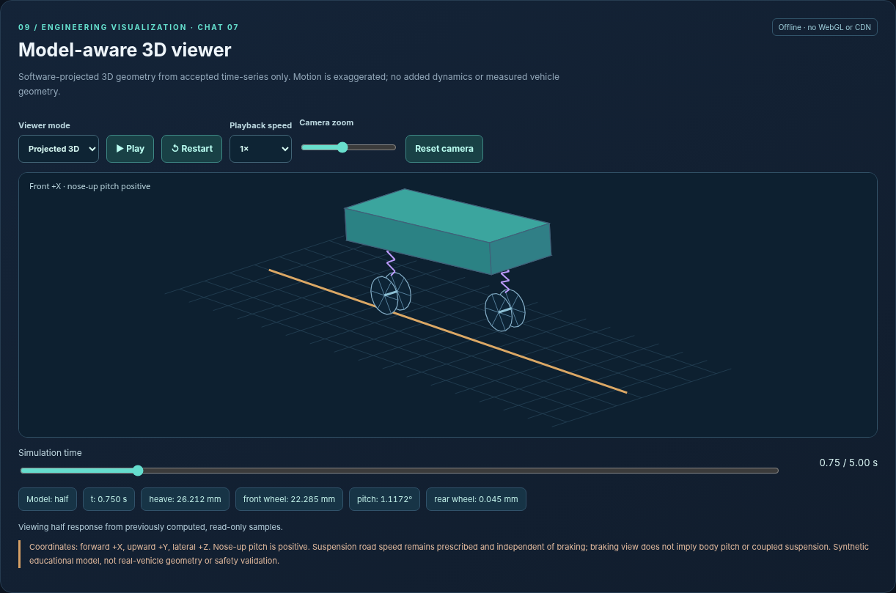
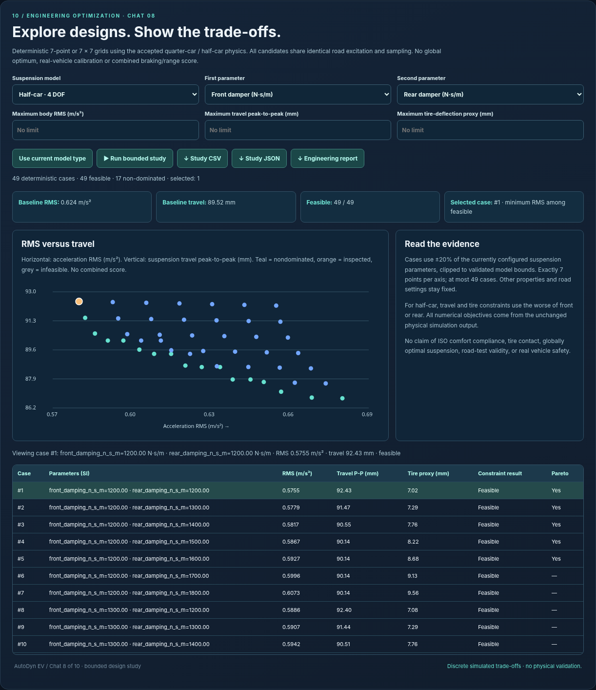

# AutoDyn EV

**Vehicle Dynamics & Engineering Trade-off Laboratory · v1.0.0**

A reproducible Python simulator for exploring how suspension parameters, road inputs, braking demand and regenerative limits change vehicle response. Built as a Mechanical Engineering / EV dynamics portfolio project by Harsh Vardhan Tomar.



## Four independent physics modes

| Mode | What you can investigate |
| --- | --- |
| Quarter-car · 2 DOF | Sprung/unsprung vertical response, acceleration, suspension travel and tire-deflection proxy |
| Half-car · 4 DOF | Body heave/pitch, front/rear wheel response and prescribed-speed road delay |
| Braking & load transfer | Friction-limited stopping, ramped brake demand and quasi-static axle loads |
| Regenerative braking · EV | Torque/power/battery limits, friction blending and energy accounting |

Road studies, modal analysis, time-step sensitivity, baseline comparisons and bounded 7-/49-case Pareto studies make the assumptions and trade-offs inspectable. A projected 3D viewer provides playback, scrubbing, camera controls and a 2D fallback. CSV, JSON and study reports support reproducibility.



## Run locally

Requires Python 3.10 or later. No third-party runtime packages, npm build or external API keys are needed.

```bash
git clone https://github.com/harshvtomar/autodyn-ev.git
cd autodyn-ev
python3 -m unittest discover -s tests -v
python3 -m autodyn_ev.server --port 8776
```

Open http://127.0.0.1:8776/ in Chrome or Safari. Keep the server running. If that port is already occupied, choose another unused port. On Windows, use `python` if `python3` is unavailable.

**Public demo:** not deployed. The interactive simulator requires its Python backend; copying the UI to static hosting does not provide working simulations.

## Verification and reproducible results

The corrected source passes **393 automated tests**: 391 inherited tests plus two regression tests ensuring the release audit accepts Git repositories and worktrees. See [executed local test log](docs/PUBLICATION_TEST_LOG.txt) and [verification scope](docs/CHAT10_VERIFICATION_REPORT.md). Hosted workflow results are available in the repository's Actions tab once completed.

| Scenario | Calculated result |
| --- | --- |
| Default quarter-car, 300 kg sprung mass | 0.906082 m/s² RMS acceleration |
| Same road and settings, 500 kg sprung mass | 0.555692 m/s² RMS acceleration |
| Default half-car, 2.5 m wheelbase at 5 m/s | 0.500 s rear axle road delay |
| Idealized braking, 20 m/s and 5 m/s² | 4.00 s, 40.00 m |
| Default regenerative example | 76.64 kJ recovered into battery from 240 kJ initial kinetic energy |

```bash
python3 scripts/chat10_release_audit.py --out docs/local_release_audit.json
python3 -m scripts.export_example
# With the server running:
python3 scripts/check_mass_update.py --port 8776
```

The archive also includes historical browser, download-content and no-drift reports. Their provenance and limitations are recorded; they are not new hosted deployment tests.

## Architecture

- `autodyn_ev/`: deterministic physics, RK4 suspension integration, analytical braking events, studies and local HTTP API.
- `web/`: HTML/CSS/JavaScript dashboard, Canvas graphs and projected 3D/2D viewer.
- `tests/`: numerical, API, validation, compatibility and presentation checks.
- `scripts/`: reproducibility, optional independent references and release checks.
- `examples/reviewed_exports/`: correctly paired CSV/JSON examples and source manifest.
- `docs/`: engineering assumptions, test evidence and all ten development milestones.

## Engineering scope

This is an **educational numerical simulator**, not a calibrated vehicle, certified braking system or road-safety tool. The four models are independent: braking speed does not drive suspension road timing. Linear suspension and small-angle pitch assumptions apply. Tire deflection does not model contact loss. Regeneration uses illustrative constant efficiency, without SOC/temperature or measured motor maps. No ABS, slip, ISO ride certification or global design optimum is claimed. Passing software tests does not establish experimental accuracy.

Historical export version fields are compatibility identifiers. [Export guide](docs/EXPORT_GUIDE.md) explains scenario pairing, RMS conventions and braking command columns.

## Documentation and portfolio

- [Engineering guide](docs/FINAL_ENGINEERING_GUIDE.md)
- [Portfolio case study and interview discussion](docs/PORTFOLIO_CASE_STUDY.md)
- [Current known issues](docs/KNOWN_ISSUES_CHAT10.md)
- [Development history](docs/DEVELOPMENT_HISTORY.md)
- [Publication and hosting plan](docs/PUBLICATION_PLAN.md)

## License

No open-source license has been selected. See [license decision](LICENSE_DECISION.md). Do not assume MIT or Apache licensing.
