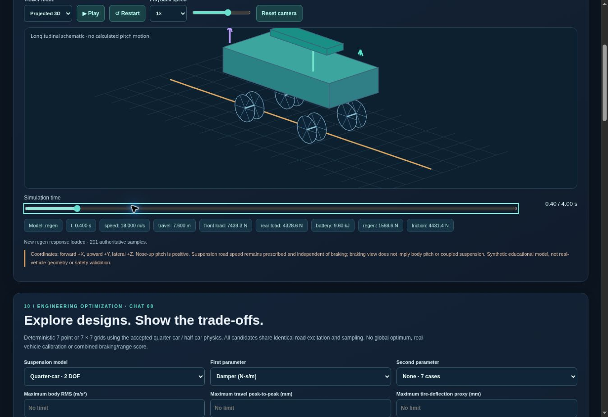

# Public simulator verification — 30 October 2026

URL: https://autodyn-ev.onrender.com/

Render service srv-dbhvfrmc6qcc73f3eaa0, AutoDyn EV workspace, confirmed Free plan, one instance, Virginia. Existing live deployment dep-dbhvfruc6qcc73f3eb4g runs commit 34614292ad6c5bb76a6250b8b72fd909e13b73e1. Subsequent publication commits change documentation only. No new paid resources or payment details were configured.

## Executed public checks

- HTTPS UI loaded after an observed cold start; /api/health returned HTTP 200, status ok and final_release_version 1.0.0. Older version fields are retained compatibility identifiers.
- Quarter-car UI and API: 300 kg RMS 0.9060817384; 500 kg RMS 0.5556923126 m/s². UI visibly recalculated to 0.556.
- Half-car UI/API: RMS 0.623450 m/s², 1,001 samples, 0.500 s axle delay.
- Braking UI/API: 4.00 s, 40.00 m stop, 201 samples.
- Regeneration UI/API: 76.638655 kJ stored, 31.9328% recovery, zero reported final energy budget residual.
- Projected 3D playback, camera rotation key, zoom and time scrubbing exercised; 2D fallback displayed.
- Seven-case bounded optimization completed: seven feasible, seven nondominated cases for the tested 500 kg scenario.
- Browser CSV and JSON downloads inspected: CSV has 1,001 rows and 12 columns; JSON records 500 kg and RMS 0.5556923126.

## Local and CI evidence

Attached corrected source SHA-256: 8389dc731862e24e2e71bbaf79d051f5932607109a8f34e4132411ec778cf4f9. All 393 release-source tests and 396 hosting-branch tests passed again. Release audit passed 8/8. All attachment source files are preserved; differences before this documentation update were confined to README plus additive hosting files.

Verified CI: https://github.com/harshvtomar/autodyn-ev/actions/runs/41015654145 (Python 3.10–3.13). Release: https://github.com/harshvtomar/autodyn-ev/releases/tag/v1.0.0. The existing lightweight release tag was preserved, not rewritten.

## Limits

Free-service cold starts and resource limits apply. This is a functional educational demo, not production availability or load-testing certification. These checks are representative, not exhaustive browser coverage. Historical 46-browser/24-export/14-no-drift evidence is not counted as a new rerun. No real vehicle calibration, safety certification or open-source license is claimed.

